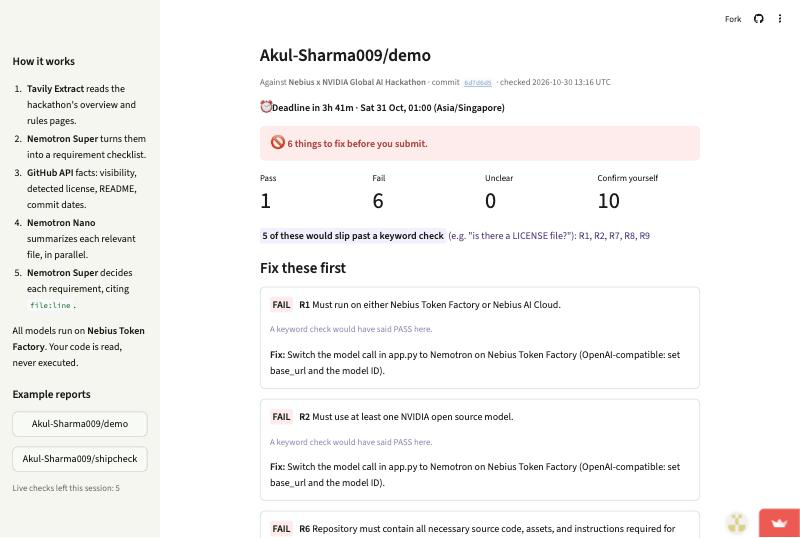

# 🚢 ShipCheck

**Pre-judge your hackathon submission before the judges do.**

Paste a hackathon URL and your GitHub or GitLab repo. In about 30 seconds ShipCheck gives you:
- a pass/fail verdict on every submission requirement in *that* hackathon's rules, each citing the file and line it's based on
- a one-line fix under every failure
- a ready-to-paste README section for README failures

- **Live demo:** https://shipcheck.streamlit.app
- **Demo video:** <TODO: YouTube URL>
- **Built for:** Nebius x NVIDIA Global AI Hackathon, *Best Apps and Agents* track

[](https://shipcheck.streamlit.app/?report=ex-demo-broken)

*A report on [a deliberately broken demo repo](https://github.com/Akul-Sharma009/demo/tree/6d7d6d5). Its LICENSE file exists but is modified MIT, so GitHub can't detect it. Its README has a Setup heading with no commands, and claims Nemotron on Token Factory while `app.py` calls `gpt-4o-mini`. A keyword check passes five of these requirements; ShipCheck fails all of them, citing the line. [Open this report](https://shipcheck.streamlit.app/?report=ex-demo-broken).*

## What it does

Submissions lose points, or get disqualified, for avoidable reasons:
- a license file GitHub can't detect
- a README with no setup steps
- required model or platform usage that is never called out
- a demo video that is private, unlisted or 20 seconds too long

Rules pages run to 40,000 characters, and nobody rereads them at 11 PM. ShipCheck does.

1. **Reads the hackathon's own rules.** It works on any Devpost hackathon and extracts the requirements and judging criteria live. Two other hackathons (PayPal AI, Atlassian Codegeist) work unchanged.
2. **Checks the repo against them:**
   - **Facts from the GitHub API:** visibility, *GitHub's own* license detection, README, commits during the submission period. Only the checks this hackathon's rules ask for count.
   - **AI verdicts for everything else**, with `path:line` evidence.
3. **Checks the Devpost submission too** (optional):
   - Is the YouTube video public, and under the stated limit? This uses YouTube's public page metadata, with no AI.
   - Does your write-up cover description, feedback and "what changed"? A pass must quote your text.
4. **Tells you what to fix, first.** Failures come first, with a concrete fix. README failures get a drafted section, built only from files ShipCheck read.
5. **Shows progress.** Rerun after pushing a fix and the report shows what changed since the last commit (**FIXED** / **NEW PROBLEM**), with a countdown to the deadline in your timezone.

**Built to avoid false passes.** A false "all clear" is the costly error, because it gets you disqualified while you think you're fine. So:
- GitHub's facts override the model.
- Every AI "pass" must cite a file ShipCheck actually read, or a quote that appears in your text. Otherwise it's downgraded to "unclear".
- Model IDs and services the model claims to have seen are dropped unless they appear in that file.
- A README claim can't pass a usage requirement. "Uses an NVIDIA model", "runs on Token Factory" and "README must highlight…" need an NVIDIA model ID or Nebius endpoint in code or config. If the code names another provider instead, they fail with that line.

## How it uses NVIDIA Nemotron and Nebius Token Factory

Every model call goes to **NVIDIA Nemotron 3 models served by Nebius Token Factory**, through its OpenAI-compatible API (`shipcheck/llm.py`). Each job is routed to the smallest model that does it well:

| Job | Model | Reasoning | Why |
|---|---|---|---|
| Rules pages → structured checklist (`rules.py`) | **Nemotron 3 Super** (`nvidia/nemotron-3-super-120b-a12b`) | off | Transcription, not reasoning: 11 s and 2.5K output tokens with thinking off, vs 69 s and 14K with it on, with the same checklist. |
| Per-file evidence, ~25 files in parallel (`evidence.py`) | **Nemotron 3 Nano** (`nvidia/NVIDIA-Nemotron-3-Nano-30B-A3B`) | off | Many small calls. Turning thinking off cut output from 227 to 25 tokens per call. |
| Requirement verdicts with `path:line` evidence (`judge.py`) | **Nemotron 3 Super** | on | The one step that needs reasoning over rules, repo facts and evidence. |
| Devpost write-up verdicts (`submission.py`) | **Nemotron 3 Super** | on | Runs in parallel with the repo verdicts. |
| README fix drafts (`drafts.py`) | **Nemotron 3 Super** | off | About 2 s per draft. |

**Where Token Factory accelerated the workflow:**
- **The OpenAI-compatible endpoint** let us use the standard `openai` SDK. Model IDs live in environment variables, so a model swap is a config change.
- **Per-request reasoning control** (`chat_template_kwargs.enable_thinking`) let us turn thinking off for extraction and on only where verdicts need it. That took the rules step from 69 s to 11 s.
- **Parallel Nano calls** keep a full check at about 30 s: roughly 28 calls, ~85K tokens in and ~7K out.

Every call goes through `call_json()`:
- `max_tokens` is required, with a hard ceiling.
- Output is validated with Pydantic and retried once on invalid JSON, or with a bigger budget if reasoning truncated it.
- If it still fails, the verdict is "unclear" rather than a guess.

Nemotron 3 Ultra was tested in pre-flight. We left it out, because Super covered every job at lower latency.

**Other Nebius services:** none. Token Factory is the only Nebius service used.

## Tavily usage

**Tavily Extract** is a runtime call on every uncached hackathon (`shipcheck/rules.py`). It reads the Devpost overview and `/rules` pages in one request. ShipCheck then:
- strips site navigation, images and duplicate lines (e.g. 40K → 37K characters)
- has Nemotron Super turn the text into the checklist

If extraction fails, users can paste the rules text instead.

## Architecture

```
hackathon URL ─► Tavily Extract ─► clean ─► Nemotron Super ─► Rules (requirements, criteria, dates)
                                                                  │
repo URL ─► GitHub API ─► facts + deterministic checks (D1–D5) ───┤
                    └─► file selection (≤40 files, ≤200 KB) ─► Nemotron Nano ×N (parallel)
                                     └─► grep lines with path:line ──┤
                                                                  ▼
                                          Nemotron Super ─► verdicts ─► grounding + overrides
Devpost write-up ─► Nemotron Super (parallel) ───────────────────────┤
YouTube link ─► watch-page metadata (public? length?) ──────────────┤
                                                                  ▼
                                    Streamlit report card (+ cache, caps, examples)
```

## Run locally

Requires Python 3.9+ (tested on 3.9 and 3.11).

```bash
git clone https://github.com/Akul-Sharma009/shipcheck.git
cd shipcheck
python3 -m venv .venv && source .venv/bin/activate
pip install -r requirements.txt
cp .env.example .env   # then fill in the three keys
streamlit run app.py
```

Keys needed in `.env` (or Streamlit secrets):
- `NEBIUS_API_KEY`: from the Token Factory console
- `TAVILY_API_KEY`
- `GITHUB_TOKEN`: a read-only, public-repos token

Command-line run, the same pipeline without the UI:

```bash
python -m shipcheck.cli https://nebiusglobalaihackathon.devpost.com/ https://github.com/you/your-project
```

### Configuration

All optional; see `.env.example`.

| Variable | Default | Purpose |
|---|---|---|
| `MODEL_NANO` / `MODEL_SUPER` / `MODEL_ULTRA` | verified Token Factory IDs | Model IDs are case-sensitive |
| `MAX_FILES` | 40 | Files read per repo |
| `MAX_RUNS_PER_SESSION` | 5 | Live checks per browser session |
| `MAX_UNCACHED_RUNS_PER_DAY` | 30 | Daily cap on paid runs |
| `SHIPCHECK_LIVE` | true | `false` = never call paid APIs; serve saved example reports only |

## GitHub Action

Check your repo on every push. The report goes to the job summary.

```yaml
name: ShipCheck
on: [push, workflow_dispatch]
jobs:
  shipcheck:
    runs-on: ubuntu-latest
    steps:
      - uses: Akul-Sharma009/shipcheck@master
        with:
          hackathon-url: https://nebiusglobalaihackathon.devpost.com/
          fail-on: fail
          nebius-api-key: ${{ secrets.NEBIUS_API_KEY }}
```

| Input | Default | Purpose |
|---|---|---|
| `hackathon-url` | required | Devpost page of the hackathon |
| `repo` | this repo | Repo URL to check |
| `ref` | `github.sha` | Commit to check |
| `fail-on` | `fail` | `fail`, `unclear` (also fails on unclear) or `never` |
| `nebius-api-key` | required | Nebius Token Factory key |
| `tavily-api-key` | none | Only needed for hackathons whose rules are not bundled in `examples/rules/` (the Nebius hackathon is bundled) |
| `github-token` | `github.token` | Reads the repo |

Outputs: `pass`, `fail`, `unclear` (counts) and `report-path` (Markdown file on the runner).

## Cost and safety guardrails

- **Caching.** Results are cached by (commit SHA, hackathon, submission text), so rerunning the same commit is free. Rules are cached per hackathon, so the checklist doesn't change between reruns. This hackathon's rules are bundled in `examples/rules/`, so the demo doesn't depend on the Devpost page staying up.
- **Run caps.** Each browser session and each day has a cap on live checks. When one is hit, or Token Factory is unavailable, the app shows a saved example report instead of failing.
- **Read-only.** ShipCheck reads code and never executes it. Private repos are refused before anything is read. An expired GitHub token falls back to unauthenticated access.
- **Secrets.** Keys come from Streamlit secrets or `.env`, which is never committed.

## Evaluation

We ran a head-to-head on 4 real entries to this hackathon, pinned to a commit each. It covers 28 requirement labels (6 true fails), from a blind independent reviewer. Details and caveats are in [eval/RESULTS.md](eval/RESULTS.md).

| Method | Accuracy | False-pass rate |
|---|---|---|
| **ShipCheck** | **100%** (28/28) | **0%** |
| One Nemotron Super call with the whole repo pasted in | 89% | 0% |
| Keyword check ("is there a LICENSE file?") | 82% | 17% |

The keyword check's false pass was a real entry with a truncated MIT license. GitHub doesn't detect it, so the rules count it as unlicensed. The sample is small, so read it as "at least as good, with fewer errors", not as a precise accuracy figure.

## Limitations

- **Public GitHub and GitLab.com repos, and Devpost hackathons, only.** Self-hosted GitLab is not supported. Other hackathon platforms work if you paste the rules text.
- **AI verdicts can be wrong.** They are constrained to cite evidence, but treat "unclear" as "go look". The evaluation above is small (28 labels).
- **Usage detection reads model IDs and endpoints, not behaviour.** A repo that sets its model only through an environment variable, with no ID in any file ShipCheck reads, gets "unclear" for model usage rather than a pass.
- **The GitHub Action hasn't run on a real runner yet.** The CLI it wraps is tested; the composite action itself is not.
- **Video checks cover the essentials only:** visibility and length. ShipCheck doesn't watch the content.
- **Large repos:** at most 40 files (12K characters each) are read, prioritising files that name a platform or model.
- **Sleeping demo:** the hosted demo runs on Streamlit Community Cloud, which sleeps after inactivity. If you see "This app has gone to sleep", click *Yes, get this app back up* and wait about 30 s.

## Project structure

```
app.py                  Streamlit UI (report card)
action.yml              GitHub Action (composite) wrapping the CLI
shipcheck/
  config.py             secrets, model IDs, limits
  llm.py                Token Factory client, call_json() with validation + retry
  rules.py              Tavily Extract → clean → Super → Rules
  repo.py               GitHub + GitLab ingestion, file selection, deterministic checks
  evidence.py           Nano per-file evidence (parallel) + grounding, path:line grep
  judge.py              Super verdicts, deterministic overrides, false-pass guard, code-usage check
  submission.py         YouTube video facts, Devpost write-up verdicts
  drafts.py             README fix drafts
  pipeline.py           one run → Report
  guard.py              cache, run caps, examples
  render.py             counts, fix list, diff, countdown, Markdown export
  cli.py                command-line runner (--ref, --markdown, --fail-on)
examples/               saved reports + bundled rules (offline demo)
eval/                   head-to-head evaluation: labels, harness, results
```

## License

MIT. See [LICENSE](LICENSE).
